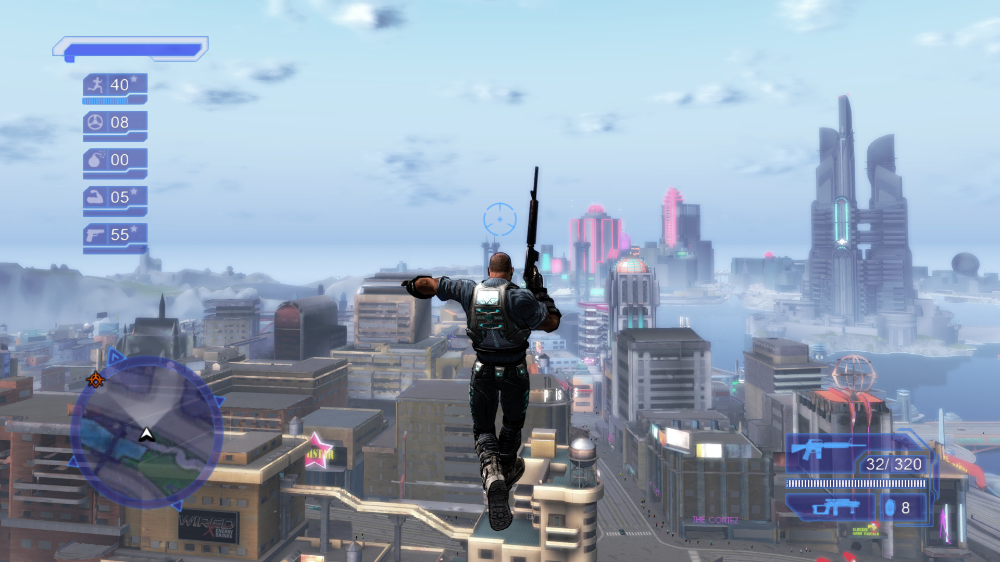
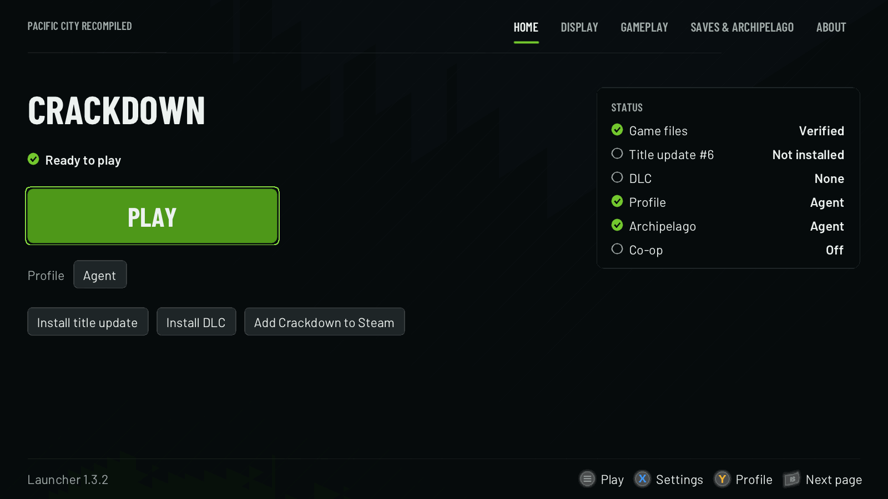
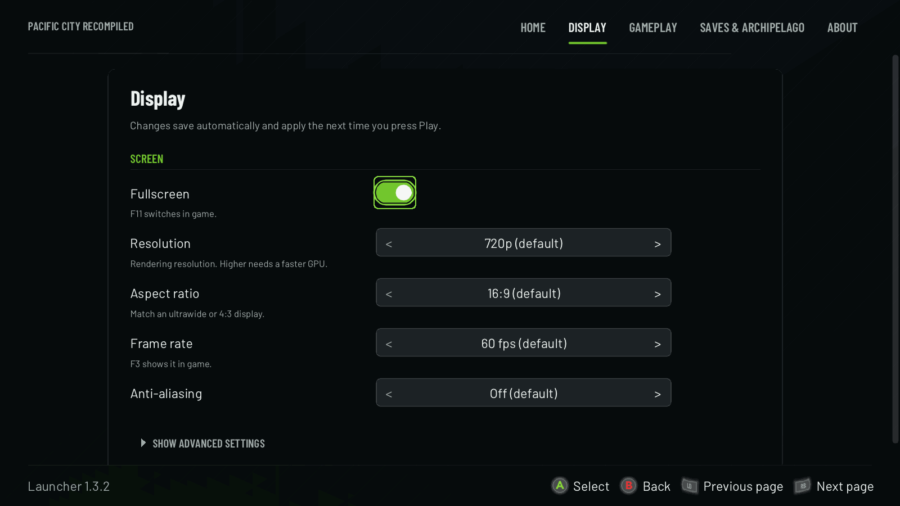
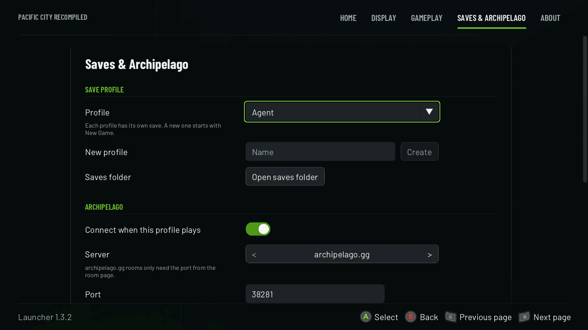
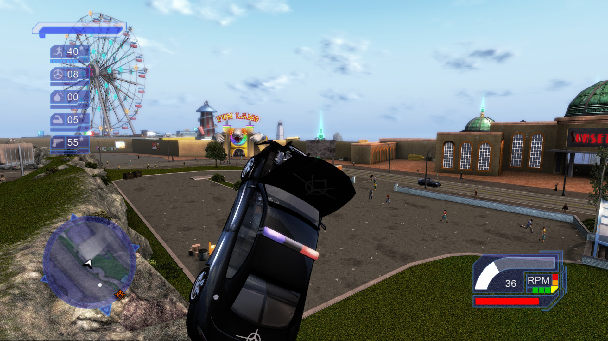
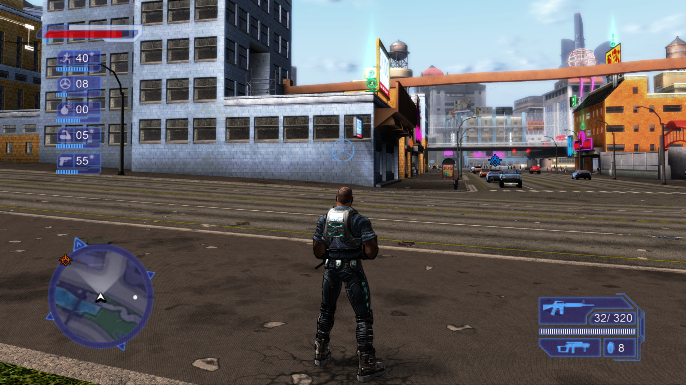
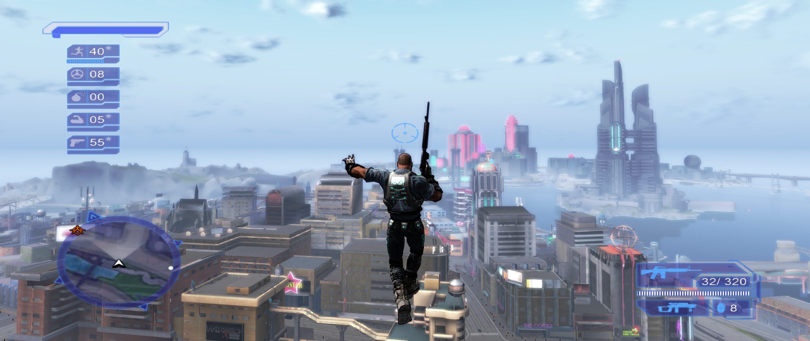

# Crackdown Recomp

**Crackdown (Xbox 360, 2007), recompiled to run natively on Windows PC.**

60 fps · up to 4K · ultrawide · controller-friendly launcher · mouse and keyboard · co-op · Archipelago

**[Download 1.3.2](https://github.com/pacific-city-recompiled/crackdown-recomp/releases/latest)** ·
**[Setup guide](https://github.com/pacific-city-recompiled/crackdown-recomp/blob/main/SETUP.md)** ·
**[Report a problem](https://github.com/pacific-city-recompiled/crackdown-recomp/issues)** ·
**[Crackdown 2](https://github.com/pacific-city-recompiled/crackdown-2-recomp)**

Crackdown Recomp is an unofficial native PC port of Crackdown. It is not an emulator: the game's
Xbox 360 code is translated ahead of time (static recompilation) into a Windows program, then fixed
and extended for modern PCs. A launcher installs the game from **your own** disc, checks every file,
keeps your settings and saves, and works fully with a controller.

> [!IMPORTANT]
> No game files are included. You need your own dump of the **Crackdown World multi-language disc**
> (ISO, XISO or an extracted folder).

## Install

### With Quiver Launcher

Find **Crackdown** in [Quiver](https://quiverlauncher.com), press **Get**, then **Play**. Quiver
downloads and updates the game; it opens the Crackdown launcher, which installs your disc on first run.

### From the release ZIP

| Download | Use it if |
|---|---|
| `Crackdown-Windows-1.3.2.zip` | You want just Crackdown. Run `CrackdownRecomp.exe`; the game sits in `cd1\` next to it. This is the package Quiver installs. |
| `CrackdownRecomp-1.3.2.zip` | You want the combined launcher that plays **Crackdown and Crackdown 2** from one install and updates itself. Run `CrackdownLauncher.exe`. |

Get either from the [latest release](https://github.com/pacific-city-recompiled/crackdown-recomp/releases/latest)
and extract the **whole** ZIP into a folder you can write to (for example `Documents\Crackdown`, not
`Program Files`). Already on 1.2.2 or newer? Use **Check for updates** in the launcher instead.

## First run

1. Open the launcher and choose **INSTALL GAME**. Pick your disc image (**DISC IMAGE (ISO)**) or an
   already-extracted folder. The launcher extracts it and checks every file against the supported version.
2. Optional: **Install title update** (Title Update #6) and **Install DLC** from the home page. The
   Four-Play Pack works on the original game; the Free-For-All Pack (Keys to the City, Street Racing)
   needs the title update. See [DLC and the title update](https://github.com/pacific-city-recompiled/crackdown-recomp/blob/main/SETUP.md#dlc-and-the-title-update).
3. When the status reads **Ready to play**, press **PLAY**.

## Controller shortcuts

The whole launcher works with a controller, so it is comfortable from the couch, in Big Picture or in Quiver.

| Button | Does |
|---|---|
| **Start** | Play (from the home page) |
| **X** | Open Settings |
| **Y** | Pick the save profile |
| **LB / RB** | Previous / next page |
| **D-pad / left stick** | Move; **left / right** changes a setting in place |
| **A / B** | Select / back |
| **LT + RT** (or F11) | Switch the launcher between fullscreen and a window |

**A** on a text box opens an on-screen keyboard (X deletes, Y types a space, Start finishes). Under
**Gameplay → Advanced** you can open the launcher fullscreen and start the game right away after a
3-second countdown (any button stops it). The launcher hides while you play and comes back when the game closes.

In game, **F3** shows the fps counter and **F11** switches fullscreen. Mouse and keyboard: turn on
**Mouse and keyboard** under Gameplay ([key map](https://github.com/pacific-city-recompiled/crackdown-recomp/blob/main/SETUP.md#mouse-and-keyboard)).

## Settings

Settings save on their own and apply the next time you press Play. Rare and debug options sit under each
page's **Show advanced settings**.

| Page | What's there |
|---|---|
| **Display** | Fullscreen, resolution (720p up to 4K), aspect ratio (16:9, 16:10, 21:9, 32:9, 4:3; wider shows more of the city, no stretching), frame rate (60 fps default, 30 fps for the original timing), anti-aliasing, texture filtering |
| **Gameplay** | Language (10, if your disc has them), skip intro logos, camera turn speed (0.25x to 4x), mouse and keyboard, co-op over System Link |
| **Saves & Archipelago** | Save profiles, the saves folder, portable mode (saves next to the game), Archipelago connection |
| **About** | Versions, verify game files, logs folder, copy system info |

<table>
  <tr>
    <td width="50%"></td>
    <td width="50%"></td>
  </tr>
  <tr>
    <td align="center">Display</td>
    <td align="center">Saves & Archipelago</td>
  </tr>
</table>

The game's own menus also have a **PC Settings** page for the graphics options.

## Archipelago randomizer (experimental)

Join an [Archipelago](https://archipelago.gg) multiworld: orbs, supply points, weapon deposits and bosses
hold items for every player in the room, and other games send you Crackdown's skills and weapons.

1. On **Saves & Archipelago**, create a save profile for the seed (one profile per seed). With a controller,
   **Create a profile for this seed** opens the keyboard.
2. Turn on **Connect when this profile plays**.
3. **Server:** keep **archipelago.gg** and type just the **port** from your room page (the number after
   `archipelago.gg:`, for example `38281`). For a self-hosted or other server, pick **Custom address** and
   enter `host:port`.
4. Enter your **slot name** and the room **password** (if any), then press **PLAY**. The game connects by
   itself; there is no separate client window.

Making a player file, generating and hosting a seed: [SETUP.md → Archipelago](https://github.com/pacific-city-recompiled/crackdown-recomp/blob/main/SETUP.md#archipelago-randomizer-experimental).

## Screenshots

<table>
  <tr>
    <td width="50%"></td>
    <td width="50%"></td>
  </tr>
  <tr>
    <td align="center">Driving at 60 fps</td>
    <td align="center">Pacific City streets</td>
  </tr>
</table>

21:9 without stretching: the extra width shows more of the city.

## Requirements

| | |
|---|---|
| OS | Windows 10 or 11, 64-bit. Steam Deck and Linux players report it runs under Proton ([notes](https://github.com/pacific-city-recompiled/crackdown-recomp/blob/main/SETUP.md#what-you-need)). |
| CPU | x64 with AVX2 and FMA3 (most Intel since 2013, AMD since 2015) |
| GPU | DirectX 12 |
| Runtime | [Microsoft Visual C++ x64 Redistributable](https://aka.ms/vs/17/release/vc_redist.x64.exe) |
| Game | Your own dump of the Crackdown World multi-language disc |

## Troubleshooting

- **"Windows protected your PC" (SmartScreen):** the files aren't code-signed. Click **More info → Run anyway**.
- **Microsoft Defender flags the launcher** (`Trojan:Win32/Bearfoos.A!ml`): a heuristic false positive on a new
  unsigned program. Restore it from **Windows Security → Protection history**, or don't run it and tell us.
- **"This app can't run on your PC" / `0xc0e90002`:** Windows Smart App Control blocks unsigned programs and has no
  per-app exception. The only way past it is turning Smart App Control off.
- **The launcher says a file doesn't match:** your disc is a different version. Only the World multi-language disc
  is supported (`default.xex` SHA256 `7aaa7a89…77e5a`).
- **The launcher finds no update** (1.2.1 to 1.3.0 checked older hosts): download the newest ZIP once and copy it
  over your install. Your game files, saves and settings stay.
- **Something else:** on **About**, use **Open logs folder** and **Copy system info**, and open an
  [issue](https://github.com/pacific-city-recompiled/crackdown-recomp/issues) with the newest `crackdown_NNN.log`.

## For developers

| Path | What's there |
|---|---|
| `crackdown/src` | Game hooks and runtime fixes on top of the [ReXGlue SDK](https://github.com/rexglue/rexglue-sdk) (submodule `sdk/`, pinned to a release) |
| `patches/sdk` | SDK fixes, applied by `build-and-run.bat` / `tools/apply-sdk-patches.sh` |
| `docs/` | Build [playbook](https://github.com/pacific-city-recompiled/crackdown-recomp/blob/main/docs/playbook.md), [reverse-engineering notes](https://github.com/pacific-city-recompiled/crackdown-recomp/blob/main/docs/re-notes.md), the [60 fps audit](https://github.com/pacific-city-recompiled/crackdown-recomp/blob/main/docs/60fps-audit.md) and design plans |

The launcher lives in its own repository,
[pacific-city-recompiled-launcher](https://github.com/pacific-city-recompiled/pacific-city-recompiled-launcher).
The recompiled C++ is generated locally from your own `default.xex`; neither it nor any game file is committed.

## Legal

Crackdown Recomp is an unofficial fan project. It is not affiliated with or endorsed by Microsoft, Xbox Game
Studios or Realtime Worlds. Crackdown and all related names and assets belong to their owners. No game data is
distributed; you must own the game and supply your own disc dump.

The source code is released under the BSD-3-Clause license, see
[LICENSE](https://github.com/pacific-city-recompiled/crackdown-recomp/blob/main/LICENSE). Third-party code keeps
its own notices (`tools/launcher-NOTICES.txt`, `sdk/LICENSE`).
